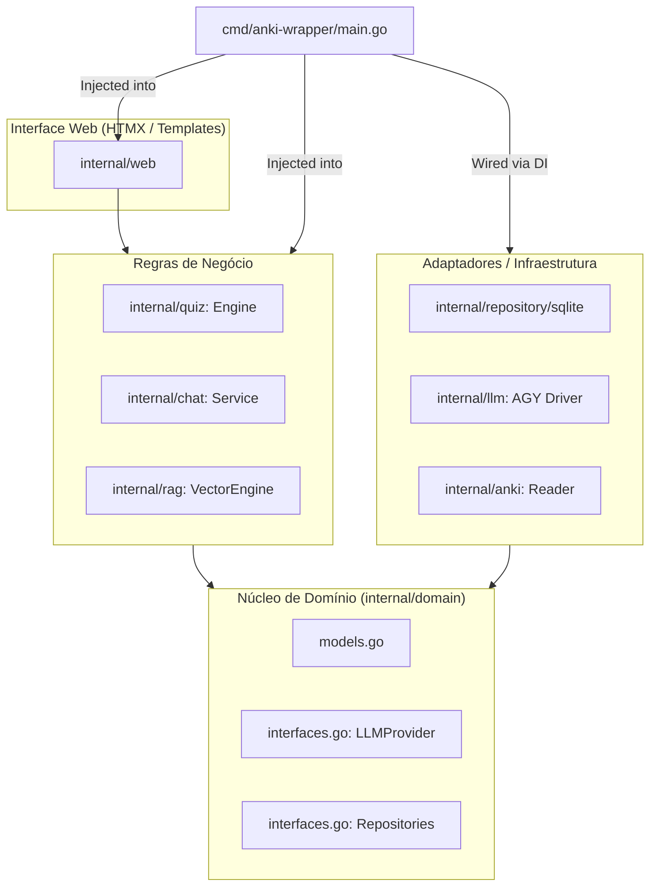

# AnkiWrapper ⛩️

> **Assistente de Japonês & Quizzes Interativos alimentados pelo seu vocabulário real do Anki e calibrados com RAG Semântico local.**

O **AnkiWrapper** é um assistente pedagógico desenvolvido em **Go + HTMX**, projetado para rodar localmente no navegador. Ele atua como parceiro de conversação em japonês e gerador dinâmico de quizzes sob medida, aproveitando a inteligência do Gemini/Antigravity CLI (`agy`) com seu plano de assinatura local (zero custo de API externa).

Projetado sob princípios de **Clean Architecture**, **Dependency Injection** e o **Repository Pattern**, o sistema desacopla completamente as regras de negócio das fontes de dados e provedores de IA, permitindo trocar o banco de dados (SQLite, PostgreSQL, etc.) ou o provedor LLM (AGY, Ollama, OpenAI) com facilidade.

---

## ✨ Funcionalidades Principais

### 1. 🎯 Quizzes Dinâmicos & Gamificados
* **3 Modos Interativos**:
  * **Múltipla Escolha**: 4 alternativas contextuais com atalhos de teclado `1`, `2`, `3`, `4`.
  * **Cloze (Preenchimento de Lacunas)**: Teste prático de partículas gramaticais e flexões verbais.
  * **Composição Livre / Tradução**: Submissão de sentenças livres avaliadas pedagogicamente pela IA com nota (0-100) e sugestões de frases naturais.
* **Barra de Métricas**: Total de questões respondidas, taxa global de aproveitamento (%) e contador de **Streak** (acertos seguidos 🔥).
* **Navegação Fluida por Teclado**: Teclas `1`-`4` selecionam opções instantaneamente e tecla `Espaço` avança para a próxima questão.

### 2. 🧠 RAG Semântico de Vocabulário (Soft N+1)
* **100% Read-Only no Anki**: Lê diretamente o arquivo `collection.anki2` do Flatpak/Linux sem alterar nenhum cartão e sem exigir AnkiConnect.
* **Embeddings no SQLite Local**: Ao inicializar, calcula incrementalmente vetores semânticos densos de 128 dimensões para cada nota e salva no banco de dados local.
* **Busca por Cosseno Sub-milissegundo**: Ao pedir um tema (ex: *"Localidade"*, *"Restaurante"*, *"Partículas は vs が"*, *"Tae Kim 4.1"*), o motor busca os termos mais compatíveis da sua coleção.
* **Pronto para Yomitan**: O design da interface foi feito para coexistir perfeitamente com a extensão Yomitan no navegador, sem popups redundantes.

### 3. 💬 Conversa Pedagógica & Dúvidas
* **Chat Fluente em Japonês**: Adaptado estritamente ao nível do vocabulário que você já estuda.
* **Furigana Sob Demanda (Hover Mode)**: Kanjis exibidos de forma limpa; passe o mouse (ou toque) para revelar a leitura em kana, evitando a dependência visual.
* **Alternador Global**: Botão na barra superior para alternar entre modo *Hover* e modo *Sempre Visível*.
* **Traduções Colapsáveis**: Tradução em português recolhida por padrão para estimular a leitura autônoma.
* **Alertas Pedagógicos Gentis**: Se você errar uma partícula ou conjugação, o agente explica a correção com brevidade e gentileza.
* **Barra Lateral Multiconversa**: Histórico de chats com auto-geração de títulos pela IA.

### 4. ⚙️ Project Prompts (Runtime Tuning)
* Tela dedicada para inspecionar e editar em tempo real os prompts do sistema:
  * Prompt do Agente de Chat
  * Prompt do Gerador de Quizzes
  * Prompt do Avaliador de Respostas
  * Diretriz de Vocabulário Conhecido (Soft N+1)
* Alterações são salvas no repositório e passam a valer imediatamente sem reiniciar o servidor!

---

## 🏗️ Arquitetura & Modularidade

O projeto segue estritamente a separação em camadas com **Inversão de Dependência (IoC)**:



### Como plugar um novo Banco de Dados (ex: PostgreSQL)
Basta criar um pacote que implemente as interfaces definidas em `internal/domain/interfaces.go`:
```go
type PromptRepository interface { ... }
type QuizRepository interface { ... }
type ChatRepository interface { ... }
type VectorRepository interface { ... }
```
E injetar a nova implementação no `cmd/anki-wrapper/main.go`:
```go
// Substituir:
// sqliteDB, _ := sqlite.NewDB(...)
// promptRepo := sqlite.NewPromptRepository(sqliteDB)

// Por:
// pgPool, _ := pgxpool.New(ctx, "postgres://...")
// promptRepo := postgres.NewPromptRepository(pgPool)
```

### Provedores LLM Nativos Suportados
O AnkiWrapper suporta nativamente dois provedores que implementam `domain.LLMProvider`:
1. **AGY CLI Local (`llm.Driver`):** Utiliza o cliente local autenticado com a sua conta Google / Assinatura (zero custo de API externa).
2. **Google Gemini REST API (`llm.GeminiProvider`):** Comunicação direta via HTTP com a API oficial do Google AI Studio usando chave de API (`GEMINI_API_KEY`). Suporta schemas estruturados nativos e modelos como `gemini-3.8-flash`.

Qualquer provedor adicional precisa apenas satisfazer a interface `domain.LLMProvider`:
```go
type LLMProvider interface {
    ExecutePrompt(ctx context.Context, prompt string) (string, error)
    ExecuteStructured(ctx context.Context, prompt string, schema string, target any) error
}
```

---

## 📁 Estrutura de Diretórios

```text
AnkiWrapper/
├── cmd/
│   └── anki-wrapper/
│       └── main.go                 # Composition Root (Dependency Injection, CLI & Flags)
├── internal/
│   ├── domain/                     # Camada de Domínio pura (zero dependências externas)
│   │   ├── models.go               # Structs: VocabItem, PromptItem, QuizRecord, ChatSession...
│   │   └── interfaces.go           # Interfaces: LLMProvider, Repositórios, VocabReader
│   ├── repository/
│   │   └── sqlite/                 # Adaptador SQLite (implementa domain repos)
│   │       ├── db.go               # Inicialização e migrations automáticas (data/app.db)
│   │       ├── prompts.go          # Implementação de domain.PromptRepository
│   │       ├── quiz.go             # Implementação de domain.QuizRepository
│   │       ├── chat.go             # Implementação de domain.ChatRepository
│   │       ├── vector.go           # Implementação de domain.VectorRepository
│   │       └── sqlite_test.go      # Testes unitários completos do repositório
│   ├── llm/
│   │   ├── driver.go               # Adaptador AGY CLI Local (Assinatura)
│   │   ├── driver_test.go          # Testes de resiliência e parsing da CLI
│   │   ├── gemini.go               # Adaptador Google Gemini API Direta (Google AI Studio)
│   │   └── gemini_test.go          # Testes unitários da Gemini API com mock HTTP
│   ├── rag/
│   │   ├── vector.go               # Motor de embeddings 128-dim e similaridade de cosseno
│   │   └── vector_test.go          # Testes de dimensão, normalização e cosseno
│   ├── anki/
│   │   ├── reader.go               # Leitor read-only do collection.anki2
│   │   ├── reader_test.go          # Testes com a coleção real do Anki
│   │   └── sanitizer.go            # Sanitizador de HTML e notas do Yomitan
│   ├── quiz/
│   │   └── engine.go               # Engine de geração (com RAG) e correção de quizzes
│   ├── chat/
│   │   ├── service.go              # Serviço de conversação e gerenciamento de sessões
│   │   ├── furigana.go             # Conversor seguro de notação 漢字[かんじ] para <ruby>
│   │   └── furigana_test.go        # Testes de regressão de Furigana
│   └── web/
│       ├── server.go               # Servidor HTTP & roteamento HTMX
│       ├── handlers_quiz.go        # Handlers dos quizzes, avaliação e métricas
│       ├── handlers_chat.go        # Handlers do chat e alternância de sessões
│       ├── handlers_prompts.go     # Handlers de inspeção e edição de prompts
│       └── templates/              # Templates Go HTML com Tailwind CSS
│           ├── layout.html         # Layout base com botão de alternância de Furigana
│           ├── quiz.html           # Interface de quizzes e placar
│           ├── chat.html           # Interface de chat multiconversa
│           └── prompts.html        # Painel de customização de prompts
└── data/
    └── app.db                      # Banco de dados local SQLite gerado automaticamente
```

---

## 🚀 Como Executar

### Pré-requisitos
* **Go 1.22+** instalado.
* **Anki** instalado (detecta automaticamente o caminho padrão do Flatpak: `~/.var/app/net.ankiweb.Anki/data/Anki2/User 1/collection.anki2` ou caminho customizado via flag `-anki`).
* **`agy` CLI** instalado e configurado no PATH ou em `~/.local/bin/agy`.

### 1. Compilar e Rodar o Servidor
```bash
# Compilar o binário
go build -o anki-wrapper ./cmd/anki-wrapper

# Opção 1: Iniciar usando a CLI local do AGY (Assinatura, sem custo de API)
./anki-wrapper serve

# Opção 2: Iniciar usando a Gemini API oficial (Google AI Studio)
export GEMINI_API_KEY="sua_chave_aqui"
./anki-wrapper serve

# Ou passar a chave via flag:
./anki-wrapper serve -gemini-key "sua_chave_aqui" -gemini-model "gemini-3.8-flash"
```

Acesse no seu navegador: **[http://localhost:8080](http://localhost:8080)**

### 2. Comandos de Diagnóstico e Testes
```bash
# Rodar todos os testes automatizados
go test -v ./...

# Testar leitura e sanitização de vocabulário do Anki SQLite
./anki-wrapper test-anki

# Testar comunicação estruturada com o binário local do agy
./anki-wrapper test-agy

# Testar comunicação direta com a Gemini API (Google AI Studio)
./anki-wrapper test-gemini -key "sua_chave_aqui"

# Ver ajuda e opções de linha de comando
./anki-wrapper --help
```
